  

    

  
  
  

## About me

Hi, I'm Abim, a full-stack developer from Indonesia working across web, mobile, and machine learning. I'm doing a double degree at Politeknik Negeri Jakarta and Management and Science University in Malaysia.

I learn by building. Most things start with a real question and end with something that actually runs, whether that's a dashboard, an API, or a model. There's more on [my website](https://abiem.codes/), and I'm open to internships and collaborations.

## Tech stack

**Web**

**Data and machine learning**

 

**Mobile and tools**

